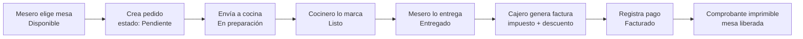
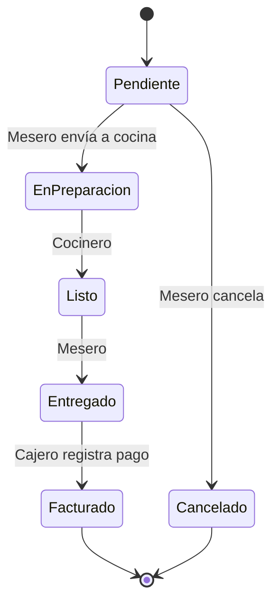
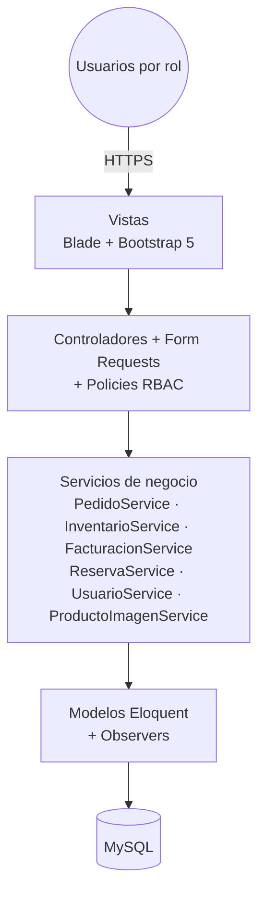
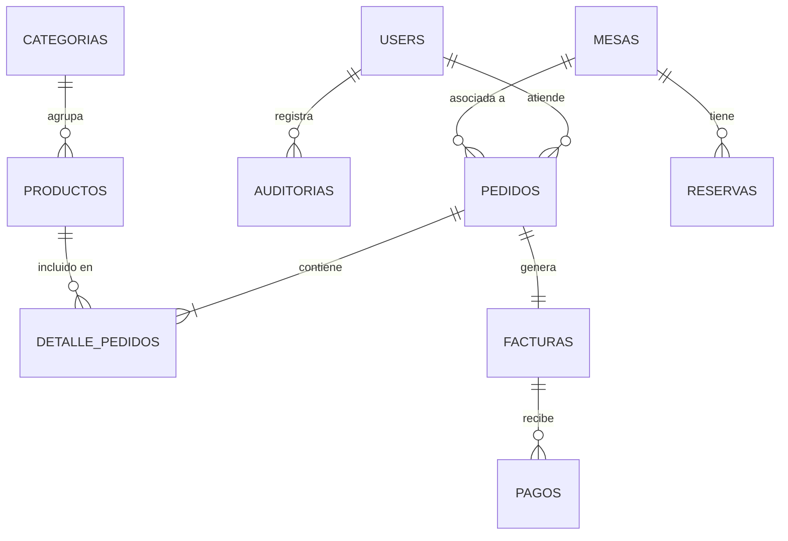

# SIAR – Documento de Producto Mínimo Viable (MVP)

**Sistema Integral de Administración para Restaurantes**
Ingeniería de Software II · Institución Universitaria Antonio José Camacho (UNIAJC) · Ingeniería en Sistemas, 6.º semestre · Cali, 2026

**Equipo:** Kevin Andrés Barona Barreiro · Natalia Solis Hijido · Johan Eduardo Restrepo
**Repositorio:** `github.com/BaronaKev/SIAR` (rama `feature/mesas-gestion_usuarios`)

---

## 1. Visión del producto

SIAR es una plataforma web responsiva que **centraliza la operación de un restaurante en tiempo real**: conecta al mesero, la cocina y la caja en un solo flujo, controla el menú y su disponibilidad según el stock, y deja trazabilidad (auditoría) de cada acción crítica.

> **Para** restaurantes pequeños y medianos de Cali
> **que** gestionan pedidos, mesas y cobros de forma manual o con sistemas desconectados,
> **SIAR es** una aplicación web de gestión integral
> **que** conecta salón, cocina y caja con control de acceso por roles,
> **a diferencia de** las comandas en papel o las hojas de cálculo,
> **nuestro producto** garantiza trazabilidad del pedido de principio a fin y cálculo automático de la factura.

---

## 2. Problema que resuelve

| Dolor actual | Consecuencia | Cómo lo resuelve el MVP |
|---|---|---|
| Pedidos tomados a mano | Errores, pedidos perdidos | Pedido digital asociado a una mesa, con estados |
| Salón y cocina desconectados | Demoras, platos olvidados | Vista de cocina con refresco automático |
| Menú desalineado con el inventario | Se venden productos agotados | Producto pasa a *Agotado* automáticamente al llegar a stock 0 |
| Facturación manual | Errores en impuestos y descuentos | Factura con impuesto configurable y descuentos validados |
| Sin control de quién hizo qué | Fraude, falta de responsabilidad | Auditoría automática y permisos por rol |

**Pregunta problema:** ¿De qué manera una plataforma web centralizada puede optimizar la gestión operativa de los restaurantes, garantizando la trazabilidad de los pedidos, la información en tiempo real y una comunicación eficiente entre los roles?

---

## 3. Usuarios y roles

| Rol | Necesidad principal | Qué hace en SIAR |
|---|---|---|
| **Administrador** | Controlar el negocio | Usuarios y roles, menú, categorías, mesas, auditoría, dashboard, reportes |
| **Mesero** | Atender mesas rápido | Consulta/reserva/libera mesas, crea y modifica pedidos, los envía a cocina, marca *Entregado* |
| **Cocinero** | Saber qué preparar | Ve la cola de cocina, marca pedidos *Listo*, cambia disponibilidad de productos |
| **Cajero** | Cobrar sin errores | Genera factura, aplica descuentos, registra pago, emite comprobante |
| **Cliente** *(fuera del MVP como actor con cuenta)* | Consultar menú y pedir | En el MVP el pedido lo registra el mesero en su nombre |

---

## 4. Propuesta de valor del MVP — el flujo crítico

El MVP se considera **exitoso** si un restaurante puede ejecutar de punta a punta este flujo (es la demostración exigida en el 2.º corte):

**Cliente → Pedido → Cocina → Factura**, con cada paso registrado en la auditoría.

---

## 5. Alcance del MVP

### 5.1 Dentro del MVP (Must have)

| Módulo | Requerimientos | Estado* |
|---|---|---|
| **1. Usuarios y seguridad** | RF001 Registrar · RF002 Editar · RF003 Eliminar (propia / admin) · RF004 Gestionar roles · RF005 Iniciar sesión · RF006 Recuperar contraseña | ✅ Implementado |
| **2. Menú** | RF007 Crear · RF008 Modificar · RF009 Eliminar (soft delete, conserva historial) · RF010 Categorías · RF011 Disponibilidad (manual y automática por stock) | ✅ Implementado |
| **3. Mesas** | RF012 Crear · RF013 Modificar · RF014 Consultar estado · RF015 Reservar · RF016 Liberar | ✅ Implementado |
| **4. Pedidos** | RF017 Crear · RF018 Agregar productos · RF019 Modificar · RF020 Cancelar · RF021 Enviar a cocina · RF022 Consultar estado | ✅ Implementado |
| **Inventario (básico)** | Stock por producto, descuento automático al confirmar pedido, *Agotado* en stock 0 | ✅ Implementado (stock en `productos`) |
| **5. Facturación** | RF023 Generar factura · RF024 Impuestos · RF025 Descuentos · RF026 Registrar pago · RF027 Comprobante | ✅ Implementado |
| **Transversal** | Auditoría (RNF006), RBAC (RNF005), contraseñas cifradas (RNF004), pruebas ≥ 70 % (RNF009) | ✅ Implementado (82 pruebas, ~83 % cobertura) |

### 5.2 Después del MVP (Should / Could have — 3.er corte)

| Funcionalidad | Requerimientos | Estado* |
|---|---|---|
| Reportes gerenciales | RF028 Ventas por periodo · RF029 Más vendidos · RF030 Consumo de inventario · RF031 Ocupación de mesas · RF032 Indicadores financieros | ⏳ Pendiente |
| Dashboard administrativo | Indicadores en tiempo real | 🟡 Versión inicial (indicadores reales en `dashboard`) |
| Reservas como módulo completo | Gestión de reservas por fecha/hora | 🟡 Implementado básico (tabla `reservas`, `ReservaService`) |
| Inventario por ingredientes y recetas | Tablas `ingredientes` / `recetas` del modelo E-R | ⏳ Pendiente |
| Despliegue en Internet | URL pública funcional | ⏳ Pendiente |
| Manual técnico y de usuario | Documentación final | ⏳ Pendiente |

### 5.3 Fuera de alcance (Won't have)

- Facturación electrónica ante la DIAN o pasarelas de pago externas.
- Aplicaciones móviles nativas.
- Integración con hardware (datáfonos, impresoras térmicas).
- Cuenta propia del cliente para pedir desde su celular.

\* *Estado según el análisis técnico del proyecto del 4 de noviembre de 2026; confirmar contra la rama actual del repositorio.*

---

## 6. Reglas de negocio clave

### 6.1 Estados del pedido (patrón State — enum `EstadoPedido`)

- Solo un pedido **Pendiente** puede modificarse o cancelarse.
- Se pueden **agregar productos** mientras el pedido no esté *Entregado* ni *Facturado*.
- No se envía a cocina un pedido **sin productos**.
- Cada transición exige un **permiso** específico (`PedidoPolicy::cambiarEstado`).

### 6.2 Mesas

- Estados: **Disponible · Ocupada · Reservada**.
- Solo se reserva una mesa *Disponible* (nombre del cliente, fecha y hora).
- Identificador de mesa **único**.

### 6.3 Menú e inventario

- Un producto con stock 0 pasa a **Agotado** y no puede agregarse a pedidos.
- Eliminar un producto es lógico (*soft delete*): el historial de pedidos se conserva.
- Al eliminar una categoría, sus productos quedan sin categoría (no se borran).

### 6.4 Facturación

- Solo se factura un pedido **Entregado**; una factura por pedido (relación 1 a 1).
- Numeración consecutiva: `FAC-000001`, `FAC-000002`, …
- **Impuesto** configurable (`SIAR_IMPUESTO_PORCENTAJE`, 8 % por defecto), mostrado como ítem separado.
- **Descuento** por porcentaje o valor fijo (patrón Strategy); nunca puede superar el subtotal.
- Métodos de pago: efectivo, tarjeta débito, tarjeta crédito, transferencia. El monto recibido debe cubrir el total.
- `Total = Subtotal − Descuento + Impuesto`.

### 6.5 Seguridad

- Contraseñas cifradas con bcrypt.
- Solo los usuarios **activos** pueden iniciar sesión.
- El administrador solo puede eliminar cuentas de Cajero, Mesero y Cocinero.
- Toda creación, edición, eliminación, inicio/cierre de sesión, cambio de rol, cancelación y factura queda en **auditoría** (usuario, fecha, hora). La contraseña nunca se guarda en la auditoría.

---

## 7. Arquitectura y diseño

**Arquitectura en capas (MVC + servicios):**

| Patrón | Dónde se aplica | Por qué |
|---|---|---|
| **MVC** | Estructura base de Laravel | Separa presentación, control y datos |
| **RBAC** | Spatie Permission + Policies por modelo | Cada rol solo ve y hace lo que le corresponde |
| **State** | `EstadoPedido` | Transiciones válidas sin cadenas de `if` |
| **Observer** | `AuditoriaObserver`, listener de login/logout | Auditoría automática y desacoplada |
| **Strategy** | `DescuentoPorcentaje`, `DescuentoValorFijo`, `DescuentoFactory` | Agregar nuevos tipos de descuento sin tocar la facturación |
| **Service Layer** | `app/Services/*` | Lógica de negocio reutilizable y testeable |

**Modelo de datos del MVP:** `users`, `roles`/`permissions` (Spatie), `categorias`, `productos`, `mesas`, `reservas`, `pedidos`, `detalle_pedidos`, `facturas`, `pagos`, `auditorias`.

**Stack:** Laravel 13 · PHP 8.4 · MySQL · Blade + Bootstrap 5 · Breeze · spatie/laravel-permission · PHPUnit · Git/GitHub.

---

## 8. Requerimientos no funcionales del MVP

| ID | Requisito | Criterio de aceptación |
|---|---|---|
| RNF001 | Web responsiva | Usable en PC, tablet y celular |
| RNF002 | Disponibilidad 95 % | ≤ 18,25 días de caída al año (aplica al desplegar) |
| RNF003 | Respuesta < 3 s | En condiciones normales de carga |
| RNF004 | Contraseñas cifradas | Hash bcrypt, nunca texto plano |
| RNF005 | Control por roles | Acceso denegado (403) fuera del rol |
| RNF006 | Auditoría | Usuario, fecha y hora de cada acción crítica |
| RNF007 | Arquitectura en capas | Vistas / controladores / servicios / modelos |
| RNF008 | Git obligatorio | Commits individuales en GitHub |
| RNF009 | Cobertura ≥ 70 % | Actual: ~83 % de líneas, 82 pruebas en verde |
| RNF010 | Documentación | Arquitectura, patrones, UML, E-R |

---

## 9. Métricas de éxito del MVP

| Métrica | Meta |
|---|---|
| Flujo *Pedido → Cocina → Factura* completo sin intervención manual | 100 % de los casos de demostración |
| Pedidos de productos agotados aceptados | 0 |
| Errores de cálculo en facturas (impuesto/descuento) | 0 |
| Acciones críticas sin registro en auditoría | 0 |
| Accesos indebidos entre roles | 0 (pruebas `RbacTest`) |
| Tiempo para registrar un pedido de 3 productos | < 1 minuto |
| Cobertura de pruebas | ≥ 70 % |

---

## 10. Guion de demostración (10 minutos)

1. **Administrador** inicia sesión → muestra dashboard, crea una categoría, un producto con imagen y stock, y una mesa.
2. **Mesero** consulta mesas → crea pedido en la mesa 1 con 2 productos → lo modifica → lo envía a cocina.
3. **Cocinero** ve el pedido en la vista de cocina (refresco automático) → lo marca *Listo*; marca un producto como *Agotado*.
4. **Mesero** intenta agregar el producto agotado (rechazado) → marca el pedido *Entregado*.
5. **Cajero** genera la factura (`FAC-000001`) → aplica 10 % de descuento → registra pago en efectivo → imprime el comprobante.
6. **Administrador** revisa la auditoría: aparecen todos los pasos con usuario, fecha y hora.
7. Ejecutar `php artisan test` y mostrar las pruebas en verde y la cobertura.

---

## 11. Hoja de ruta

| Corte | Peso | Entregable | Estado |
|---|---|---|---|
| 1.º (sem. 1–6) | 30 % | Documento de inicio, requerimientos, UML, E-R, arquitectura + CRUD Usuarios, Menú, Mesas | ✅ |
| 2.º (sem. 7–11) | 30 % | Pedidos, Inventario, Facturación + pruebas unitarias, integración y funcionales | ✅ **= MVP** |
| 3.º (sem. 12–16) | 40 % | Reportes, Dashboard, Reservas, refactorización, despliegue con URL pública, manuales, informe final | ⏳ |

---

## 12. Riesgos y brechas detectadas

| # | Brecha / riesgo | Impacto | Acción sugerida |
|---|---|---|---|
| 1 | El documento no tiene RFs propios del módulo **Inventario** | La evaluación del 2.º corte lo exige | Agregar RFs de inventario (entradas, ajustes, alertas de stock) |
| 2 | Faltan RFs de **Dashboard** y **Reservas** como módulo | Alcance del 3.er corte sin especificar | Redactar RF/HU/CU para ambos |
| 3 | E-R y diagrama de clases no coinciden (stock en Producto vs Ingrediente + Receta; Reserva y Pago solo en clases; Cliente y MetodoPago solo en E-R) | Inconsistencia en la sustentación | Unificar ambos diagramas con lo implementado |
| 4 | Relación `ROL_PERMISO`–`PERMISOS` invertida en el E-R | Error de modelado | Corregir a `PERMISOS ||--o{ ROL_PERMISO` |
| 5 | No había RF para que el cocinero marque *Listo* ni el mesero *Entregado* | Flujo incompleto en la documentación | Ya implementado vía permisos; documentarlo como RF |
| 6 | RF018 contradice HU018 (Entregado vs Entregado/Facturado); CU026 menciona pasarela (fuera de alcance); CU024–CU026 titulados "CU022" | Errores de documentación | Corregir textos y numeración |
| 7 | Requiere PHP ≥ 8.4; XAMPP puede traer una versión menor | Equipos que no logran instalar | Ver `INSTALACION.md` |
| 8 | Despliegue aún no realizado | 40 % del 3.er corte depende de URL pública | Elegir hosting (Railway, Render, Laravel Cloud, VPS) con anticipación |
