# SIAR – Mapa de pruebas

Diagramas de los casos de prueba por módulo (camino feliz y flujos alternos). Verde = éxito esperado, rojo = rechazo esperado, gris punteado = pendiente.

## Organización de la suite

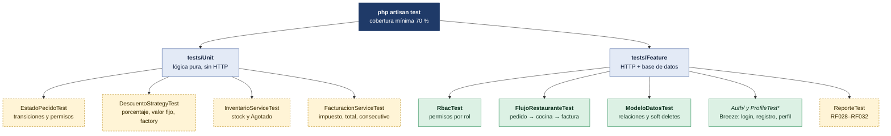

## Flujo completo: pedido → cocina → factura

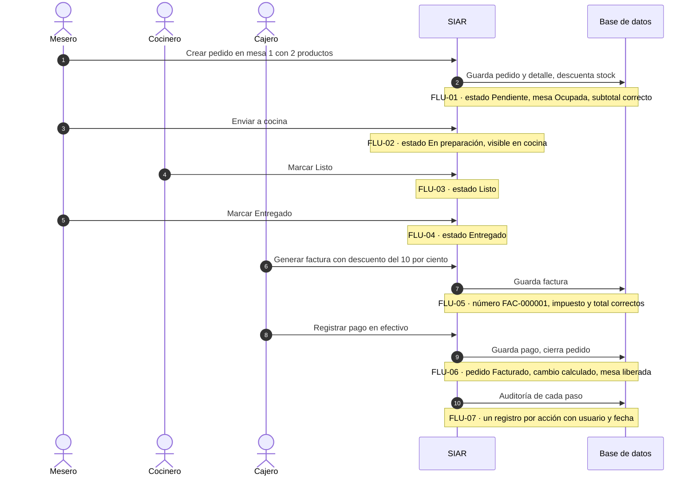

## Usuarios y autenticación (RF001–RF006)

Clases: Auth/RegistrationTest · Auth/AuthenticationTest · Auth/PasswordResetTest · ProfileTest · RbacTest

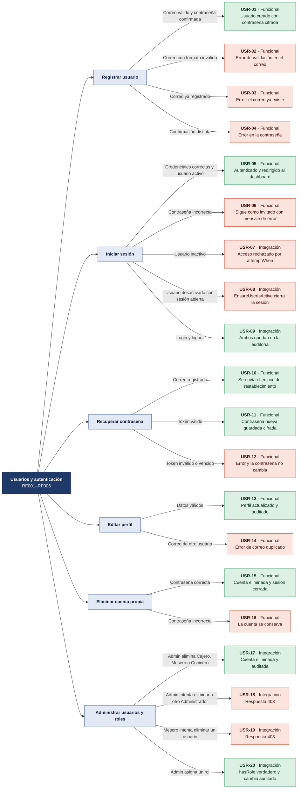

| ID | Acción | Condición | Resultado esperado | Tipo |
|---|---|---|---|---|
| USR-01 | Registrar usuario | Correo válido y contraseña confirmada | Usuario creado con contraseña cifrada | Funcional |
| USR-02 | Registrar usuario | Correo con formato inválido | Error de validación en el correo | Funcional |
| USR-03 | Registrar usuario | Correo ya registrado | Error: el correo ya existe | Funcional |
| USR-04 | Registrar usuario | Confirmación distinta | Error en la contraseña | Funcional |
| USR-05 | Iniciar sesión | Credenciales correctas y usuario activo | Autenticado y redirigido al dashboard | Funcional |
| USR-06 | Iniciar sesión | Contraseña incorrecta | Sigue como invitado con mensaje de error | Funcional |
| USR-07 | Iniciar sesión | Usuario inactivo | Acceso rechazado por attemptWhen | Integración |
| USR-08 | Iniciar sesión | Usuario desactivado con sesión abierta | EnsureUserIsActive cierra la sesión | Integración |
| USR-09 | Iniciar sesión | Login y logout | Ambos quedan en la auditoría | Integración |
| USR-10 | Recuperar contraseña | Correo registrado | Se envía el enlace de restablecimiento | Funcional |
| USR-11 | Recuperar contraseña | Token válido | Contraseña nueva guardada cifrada | Funcional |
| USR-12 | Recuperar contraseña | Token inválido o vencido | Error y la contraseña no cambia | Funcional |
| USR-13 | Editar perfil | Datos válidos | Perfil actualizado y auditado | Funcional |
| USR-14 | Editar perfil | Correo de otro usuario | Error de correo duplicado | Funcional |
| USR-15 | Eliminar cuenta propia | Contraseña correcta | Cuenta eliminada y sesión cerrada | Funcional |
| USR-16 | Eliminar cuenta propia | Contraseña incorrecta | La cuenta se conserva | Funcional |
| USR-17 | Administrar usuarios y roles | Admin elimina Cajero, Mesero o Cocinero | Cuenta eliminada y auditada | Integración |
| USR-18 | Administrar usuarios y roles | Admin intenta eliminar a otro Administrador | Respuesta 403 | Integración |
| USR-19 | Administrar usuarios y roles | Mesero intenta eliminar un usuario | Respuesta 403 | Integración |
| USR-20 | Administrar usuarios y roles | Admin asigna un rol | hasRole verdadero y cambio auditado | Integración |

## Menú y categorías (RF007–RF011)

Clases: FlujoRestauranteTest · ModeloDatosTest · ProductoTest (nueva)

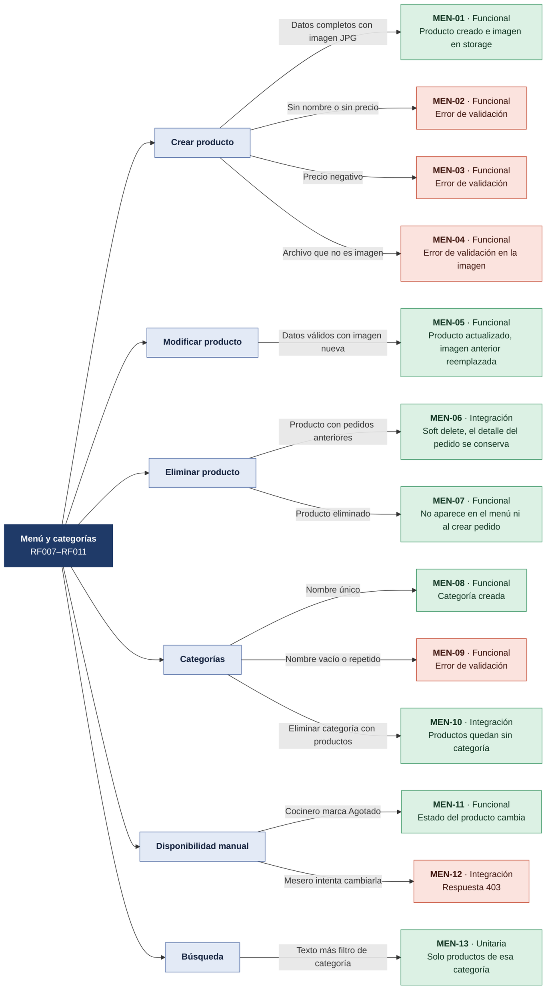

| ID | Acción | Condición | Resultado esperado | Tipo |
|---|---|---|---|---|
| MEN-01 | Crear producto | Datos completos con imagen JPG | Producto creado e imagen en storage | Funcional |
| MEN-02 | Crear producto | Sin nombre o sin precio | Error de validación | Funcional |
| MEN-03 | Crear producto | Precio negativo | Error de validación | Funcional |
| MEN-04 | Crear producto | Archivo que no es imagen | Error de validación en la imagen | Funcional |
| MEN-05 | Modificar producto | Datos válidos con imagen nueva | Producto actualizado, imagen anterior reemplazada | Funcional |
| MEN-06 | Eliminar producto | Producto con pedidos anteriores | Soft delete, el detalle del pedido se conserva | Integración |
| MEN-07 | Eliminar producto | Producto eliminado | No aparece en el menú ni al crear pedido | Funcional |
| MEN-08 | Categorías | Nombre único | Categoría creada | Funcional |
| MEN-09 | Categorías | Nombre vacío o repetido | Error de validación | Funcional |
| MEN-10 | Categorías | Eliminar categoría con productos | Productos quedan sin categoría | Integración |
| MEN-11 | Disponibilidad manual | Cocinero marca Agotado | Estado del producto cambia | Funcional |
| MEN-12 | Disponibilidad manual | Mesero intenta cambiarla | Respuesta 403 | Integración |
| MEN-13 | Búsqueda | Texto más filtro de categoría | Solo productos de esa categoría | Unitaria |

## Mesas y reservas (RF012–RF016)

Clases: FlujoRestauranteTest · RbacTest · ReservaServiceTest (nueva)

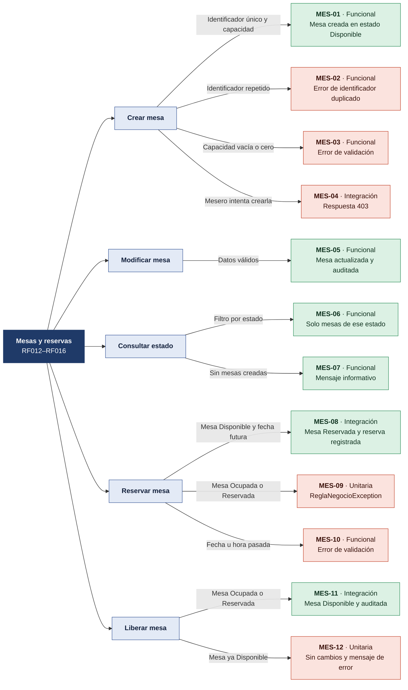

| ID | Acción | Condición | Resultado esperado | Tipo |
|---|---|---|---|---|
| MES-01 | Crear mesa | Identificador único y capacidad | Mesa creada en estado Disponible | Funcional |
| MES-02 | Crear mesa | Identificador repetido | Error de identificador duplicado | Funcional |
| MES-03 | Crear mesa | Capacidad vacía o cero | Error de validación | Funcional |
| MES-04 | Crear mesa | Mesero intenta crearla | Respuesta 403 | Integración |
| MES-05 | Modificar mesa | Datos válidos | Mesa actualizada y auditada | Funcional |
| MES-06 | Consultar estado | Filtro por estado | Solo mesas de ese estado | Funcional |
| MES-07 | Consultar estado | Sin mesas creadas | Mensaje informativo | Funcional |
| MES-08 | Reservar mesa | Mesa Disponible y fecha futura | Mesa Reservada y reserva registrada | Integración |
| MES-09 | Reservar mesa | Mesa Ocupada o Reservada | ReglaNegocioException | Unitaria |
| MES-10 | Reservar mesa | Fecha u hora pasada | Error de validación | Funcional |
| MES-11 | Liberar mesa | Mesa Ocupada o Reservada | Mesa Disponible y auditada | Integración |
| MES-12 | Liberar mesa | Mesa ya Disponible | Sin cambios y mensaje de error | Unitaria |

## Pedidos (RF017–RF022)

Clases: FlujoRestauranteTest · PedidoServiceTest (nueva)

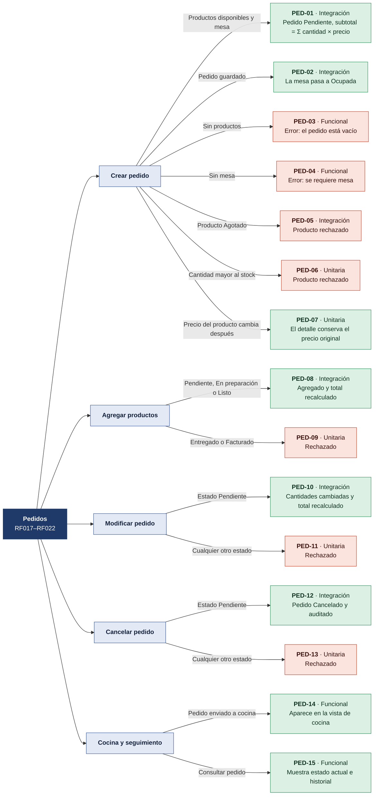

| ID | Acción | Condición | Resultado esperado | Tipo |
|---|---|---|---|---|
| PED-01 | Crear pedido | Productos disponibles y mesa | Pedido Pendiente, subtotal = Σ cantidad × precio | Integración |
| PED-02 | Crear pedido | Pedido guardado | La mesa pasa a Ocupada | Integración |
| PED-03 | Crear pedido | Sin productos | Error: el pedido está vacío | Funcional |
| PED-04 | Crear pedido | Sin mesa | Error: se requiere mesa | Funcional |
| PED-05 | Crear pedido | Producto Agotado | Producto rechazado | Integración |
| PED-06 | Crear pedido | Cantidad mayor al stock | Producto rechazado | Unitaria |
| PED-07 | Crear pedido | Precio del producto cambia después | El detalle conserva el precio original | Unitaria |
| PED-08 | Agregar productos | Pendiente, En preparación o Listo | Agregado y total recalculado | Integración |
| PED-09 | Agregar productos | Entregado o Facturado | Rechazado | Unitaria |
| PED-10 | Modificar pedido | Estado Pendiente | Cantidades cambiadas y total recalculado | Integración |
| PED-11 | Modificar pedido | Cualquier otro estado | Rechazado | Unitaria |
| PED-12 | Cancelar pedido | Estado Pendiente | Pedido Cancelado y auditado | Integración |
| PED-13 | Cancelar pedido | Cualquier otro estado | Rechazado | Unitaria |
| PED-14 | Cocina y seguimiento | Pedido enviado a cocina | Aparece en la vista de cocina | Funcional |
| PED-15 | Cocina y seguimiento | Consultar pedido | Muestra estado actual e historial | Funcional |

## Inventario (RF011 · Módulo 5 del enunciado)

Clases: InventarioServiceTest (nueva) · ModeloDatosTest

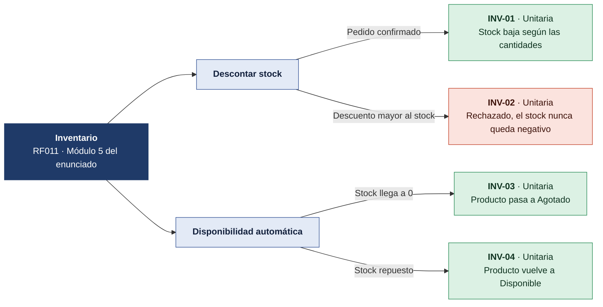

| ID | Acción | Condición | Resultado esperado | Tipo |
|---|---|---|---|---|
| INV-01 | Descontar stock | Pedido confirmado | Stock baja según las cantidades | Unitaria |
| INV-02 | Descontar stock | Descuento mayor al stock | Rechazado, el stock nunca queda negativo | Unitaria |
| INV-03 | Disponibilidad automática | Stock llega a 0 | Producto pasa a Agotado | Unitaria |
| INV-04 | Disponibilidad automática | Stock repuesto | Producto vuelve a Disponible | Unitaria |

## Facturación (RF023–RF027)

Clases: FlujoRestauranteTest · FacturacionServiceTest (nueva) · DescuentoStrategyTest (nueva)

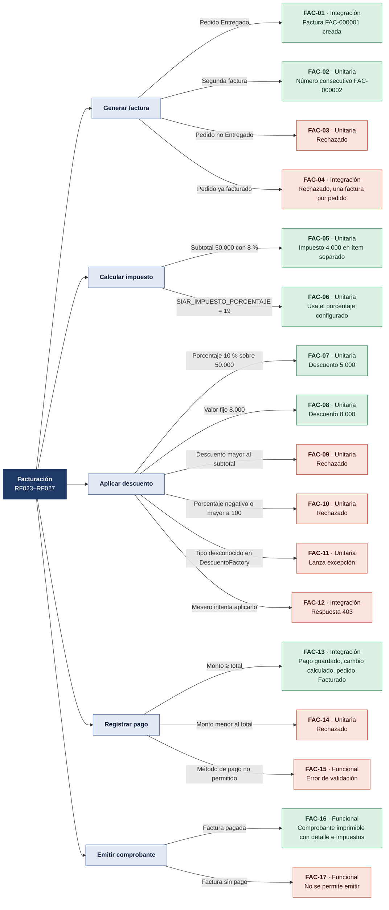

| ID | Acción | Condición | Resultado esperado | Tipo |
|---|---|---|---|---|
| FAC-01 | Generar factura | Pedido Entregado | Factura FAC-000001 creada | Integración |
| FAC-02 | Generar factura | Segunda factura | Número consecutivo FAC-000002 | Unitaria |
| FAC-03 | Generar factura | Pedido no Entregado | Rechazado | Unitaria |
| FAC-04 | Generar factura | Pedido ya facturado | Rechazado, una factura por pedido | Integración |
| FAC-05 | Calcular impuesto | Subtotal 50.000 con 8 % | Impuesto 4.000 en ítem separado | Unitaria |
| FAC-06 | Calcular impuesto | SIAR_IMPUESTO_PORCENTAJE = 19 | Usa el porcentaje configurado | Unitaria |
| FAC-07 | Aplicar descuento | Porcentaje 10 % sobre 50.000 | Descuento 5.000 | Unitaria |
| FAC-08 | Aplicar descuento | Valor fijo 8.000 | Descuento 8.000 | Unitaria |
| FAC-09 | Aplicar descuento | Descuento mayor al subtotal | Rechazado | Unitaria |
| FAC-10 | Aplicar descuento | Porcentaje negativo o mayor a 100 | Rechazado | Unitaria |
| FAC-11 | Aplicar descuento | Tipo desconocido en DescuentoFactory | Lanza excepción | Unitaria |
| FAC-12 | Aplicar descuento | Mesero intenta aplicarlo | Respuesta 403 | Integración |
| FAC-13 | Registrar pago | Monto ≥ total | Pago guardado, cambio calculado, pedido Facturado | Integración |
| FAC-14 | Registrar pago | Monto menor al total | Rechazado | Unitaria |
| FAC-15 | Registrar pago | Método de pago no permitido | Error de validación | Funcional |
| FAC-16 | Emitir comprobante | Factura pagada | Comprobante imprimible con detalle e impuestos | Funcional |
| FAC-17 | Emitir comprobante | Factura sin pago | No se permite emitir | Funcional |

## Auditoría y seguridad (RNF004–RNF006)

Clases: RbacTest · ModeloDatosTest · AuditoriaObserverTest (nueva)

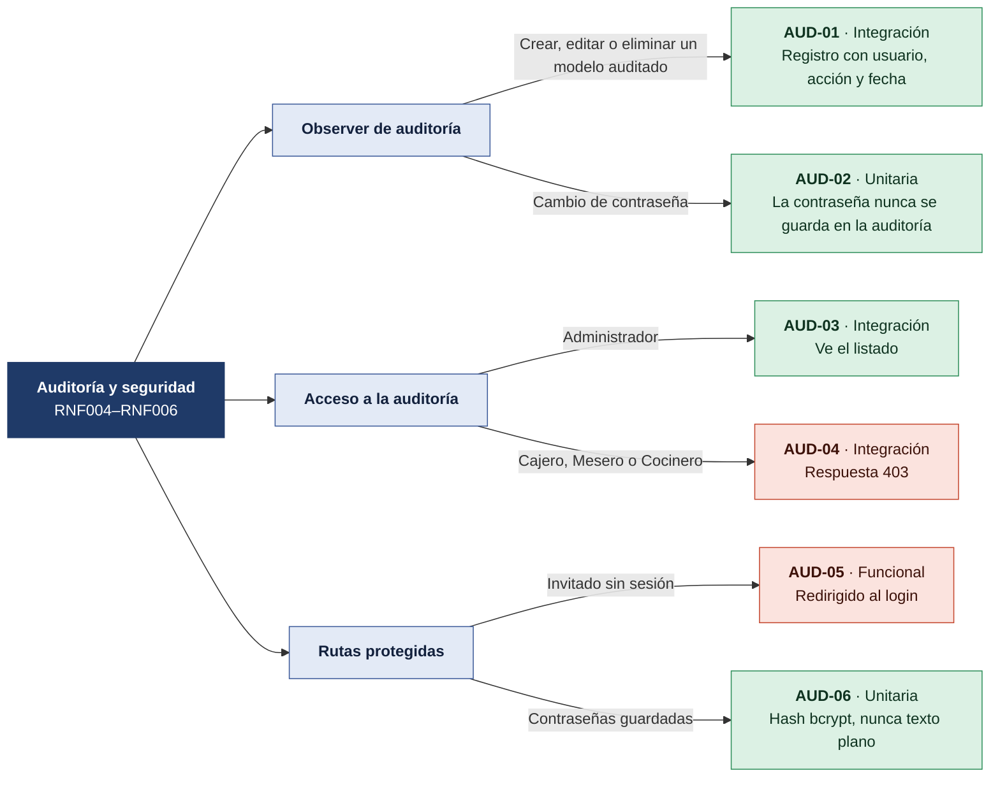

| ID | Acción | Condición | Resultado esperado | Tipo |
|---|---|---|---|---|
| AUD-01 | Observer de auditoría | Crear, editar o eliminar un modelo auditado | Registro con usuario, acción y fecha | Integración |
| AUD-02 | Observer de auditoría | Cambio de contraseña | La contraseña nunca se guarda en la auditoría | Unitaria |
| AUD-03 | Acceso a la auditoría | Administrador | Ve el listado | Integración |
| AUD-04 | Acceso a la auditoría | Cajero, Mesero o Cocinero | Respuesta 403 | Integración |
| AUD-05 | Rutas protegidas | Invitado sin sesión | Redirigido al login | Funcional |
| AUD-06 | Rutas protegidas | Contraseñas guardadas | Hash bcrypt, nunca texto plano | Unitaria |

## Reportes (pendiente) (RF028–RF032)

Clases: ReporteServiceTest y ReporteTest (por crear en el 3.er corte)

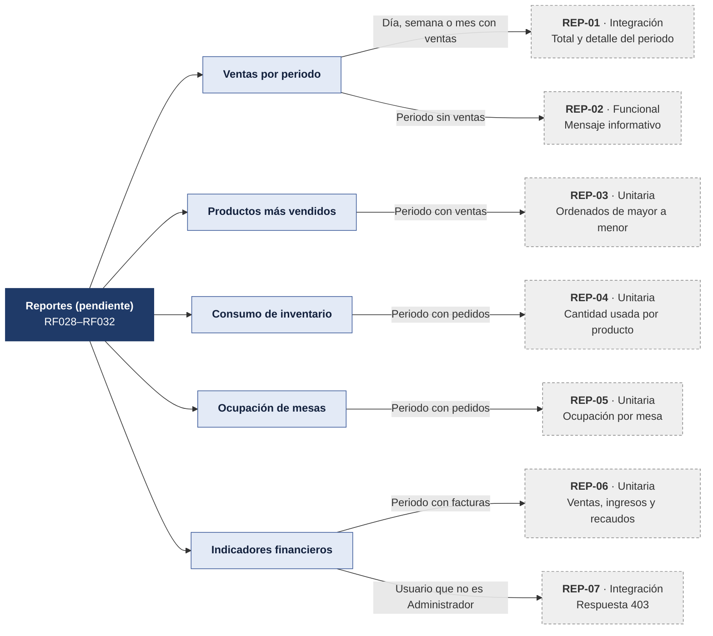

| ID | Acción | Condición | Resultado esperado | Tipo |
|---|---|---|---|---|
| REP-01 | Ventas por periodo | Día, semana o mes con ventas | Total y detalle del periodo | Integración |
| REP-02 | Ventas por periodo | Periodo sin ventas | Mensaje informativo | Funcional |
| REP-03 | Productos más vendidos | Periodo con ventas | Ordenados de mayor a menor | Unitaria |
| REP-04 | Consumo de inventario | Periodo con pedidos | Cantidad usada por producto | Unitaria |
| REP-05 | Ocupación de mesas | Periodo con pedidos | Ocupación por mesa | Unitaria |
| REP-06 | Indicadores financieros | Periodo con facturas | Ventas, ingresos y recaudos | Unitaria |
| REP-07 | Indicadores financieros | Usuario que no es Administrador | Respuesta 403 | Integración |

## Estados del pedido

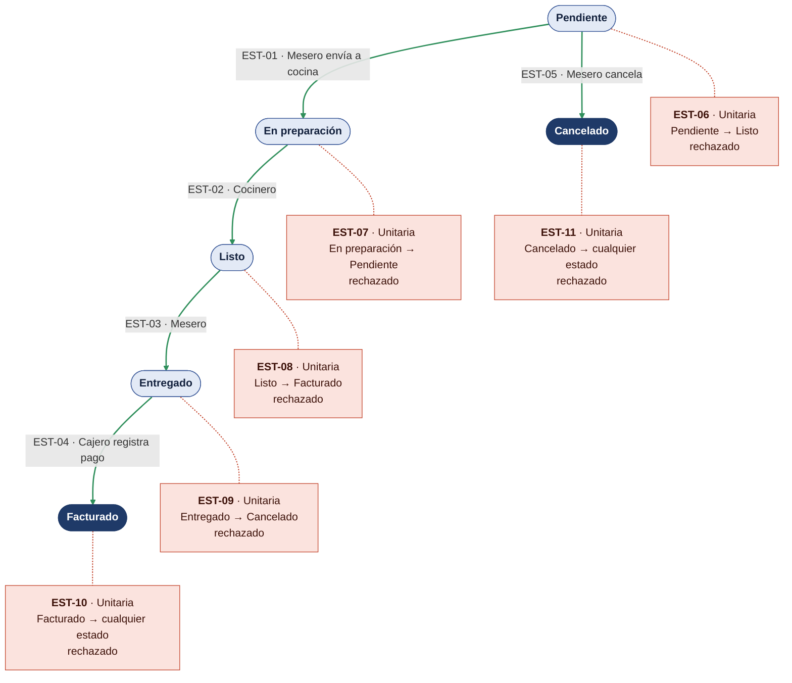

| ID | Caso | Resultado esperado |
|---|---|---|
| EST-12 | Mesero intenta marcar Listo | Respuesta 403 |
| EST-13 | Cocinero intenta marcar Entregado | Respuesta 403 |
| EST-14 | Cocinero intenta registrar el pago | Respuesta 403 |
| EST-15 | Transición válida | Queda en el historial y en la auditoría |

## Matriz de permisos (RbacTest)

| Acción | Administrador | Cajero | Mesero | Cocinero |
|---|---|---|---|---|
| Gestionar usuarios y roles | 200 | 403 | 403 | 403 |
| Crear, editar y eliminar productos | 200 | 403 | 403 | 403 |
| Cambiar disponibilidad de productos | 200 | 403 | 403 | 200 |
| Crear y editar mesas | 200 | 403 | 403 | 403 |
| Reservar y liberar mesas | 200 | 403 | 200 | 403 |
| Crear, modificar y cancelar pedidos | 200 | 403 | 200 | 403 |
| Enviar pedido a cocina | 200 | 403 | 200 | 403 |
| Marcar pedido Listo | 200 | 403 | 403 | 200 |
| Marcar pedido Entregado | 200 | 403 | 200 | 403 |
| Generar factura y registrar pago | 200 | 200 | 403 | 403 |
| Aplicar descuento | 200 | 200 | 403 | 403 |
| Ver auditoría | 200 | 403 | 403 | 403 |
| Ver reportes | 200 | 403 | 403 | 403 |